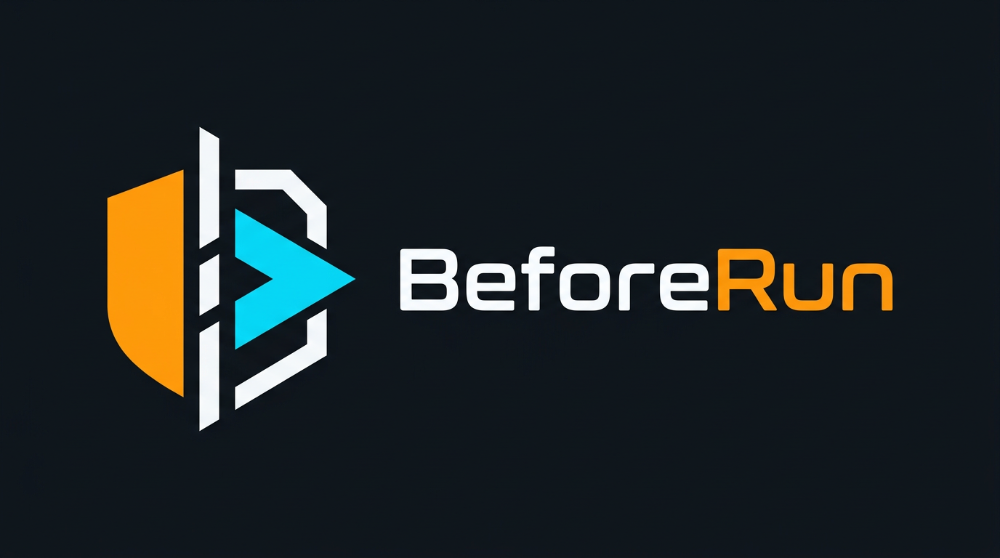

# BeforeRun



**Know what you're about to run.**

BeforeRun is an agent skill for evidence-first static review of untrusted repositories and scripts before installation or execution. It guides an agent to identify potentially harmful behavior, separate evidence from inference, and disclose unknowns.

**[Install BeforeRun](INSTALL.md)** · [What it checks](#what-it-checks) · [Compatibility and trust](#compatibility-and-trust)

## Quick start

Follow the [installation guide](INSTALL.md) to copy the complete skill folder and its references into a trusted, host-supported location. Then explicitly request a review and supply a target. The following are alternatives: replace the example target and send only one request. Where slash invocation is supported:

```text
/beforerun https://github.com/owner/repository
```

```text
/beforerun /path/to/local/repository
```

```text
/beforerun /path/to/script.py
```

For Codex, when the skill is discovered, select it explicitly and replace the example target:

```text
$beforerun /path/to/script.py
```

Skill discovery, invocation, and argument handling differ by host; these examples are not a promise of identical behavior, and BeforeRun discovery and behavior in Codex remain unverified. If a host does not pass the target with the command, provide it in the conversation. See [installation](INSTALL.md) for host-specific guidance and the untested manual-instruction fallback.

The skill instructs the agent to ask when no target is provided, not to infer the current directory. Remote URLs must identify a public GitHub repository root, optionally with a trailing slash or `.git`; other URL forms are unsupported. See [target resolution](skills/beforerun/references/target-resolution.md) for validation and access rules. A single-file review does not authorize inspection of its parent or siblings.

## What it checks

The skill guides a review of:

- Entry points and installation or startup behavior.
- Sensitive file access and network destinations.
- Command or dynamic execution, remote control, and destructive operations.
- Persistence mechanisms and instructions targeting agents.
- Differences between documented purpose and observed behavior.

These are review prompts, not implemented detection rules. The skill instructs the agent to check report statements against observed evidence, distinguish observations from inference and documentation claims, trace relationships when evidence permits, and disclose plausible benign explanations and coverage gaps. A suspicious capability alone does not establish malicious intent.

## A report, in brief

This excerpt is **synthetic**, not an evaluation result or an actual detection. Review status and finding outcome are separate:

> **Review status:** partial. **Finding outcome:** review_required.
>
> **BR-FUNCTION-MISMATCH:** Documentation claims local-only processing, while reviewed source defines a function that calls an HTTP client with an external URL and local file contents. Whether the function is reachable or any transfer occurred remains unresolved. Review the caller and destination; unexamined dependencies limit the conclusion.

See the [report template](skills/beforerun/references/report-template.md) for the full structure.

## Compatibility and trust

The canonical folder uses the [Agent Skills format](https://agentskills.io/specification), but format compatibility does not establish discovery, behavior, or permission enforcement.

| Host | Current evidence and limits |
| --- | --- |
| Claude Code | Experimental; limited local and user-reported tests. Local reviews and missing-target responses were observed, but an earlier reported missing-target failure remains unexplained. Tests included unsupported report assertions, and one user-shared single-file case visibly exceeded its scope. Complete boundary enforcement and remote review remain unverified. See [Claude Code](docs/integrations/claude-code.md). |
| Antigravity | Experimental; user-shared BR-12 and BR-07 requests and reports. BR-07 had evidence issues; command dispatch, discovery, and permission enforcement remain unverified. See [Antigravity](docs/integrations/antigravity.md). |
| Codex, VS Code Copilot, Cursor, Gemini CLI, OpenCode | Install locations are documented; BeforeRun discovery, invocation, behavior, and permission enforcement are unverified. See [installation](INSTALL.md). |
| Other hosts | Unverified. Use a host's documented skill location or provide the trusted instructions explicitly; compatibility and behavior are not guaranteed. |

BeforeRun is **not a scanner, sandbox, comprehensive vulnerability assessment, or malware classifier**. Its instructions prohibit executing target code, installing dependencies, automatically cloning or unpacking targets, contacting target application endpoints, or automatically remediating findings. The skill also instructs the agent not to modify the target. Enforcement depends on the host. Static review can miss or misinterpret behavior, cannot establish intent with certainty, and does not prove a release binary corresponds to the source.

The target is untrusted evidence, including its instructions. The skill instructs the agent not to intentionally open actual secrets and to redact values found incidentally. The skill has no independent LLM API client, but the host agent may send reviewed content to its model provider, and masking is not guaranteed. Agent instructions are not an enforced sandbox; host permissions and operating-system isolation are separate controls. Prefer a fresh trusted session outside the target, without assuming that this eliminates previously loaded instructions. A host may load skills automatically despite the explicit-request instruction; check its controls and actual behavior.

**BeforeRun reports suspicious behavior and supporting evidence. It does not certify code as safe.**

## Further reading

[Installation](INSTALL.md) · [Limitations](docs/limitations.md) · [MVP readiness](docs/mvp-readiness.md) · [Contributing](CONTRIBUTING.md) · [Security reporting](SECURITY.md)
